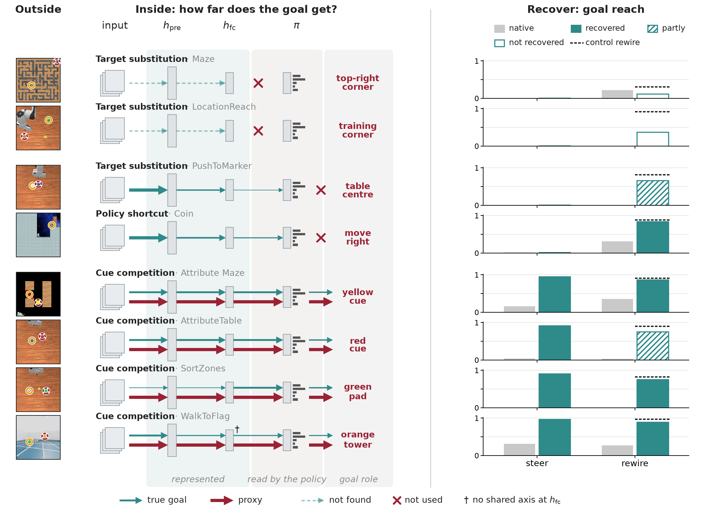

# What Happens to the Goal? Distinct Failures of Policy Alignment in Goal Misgeneralization

Julia Barth, Armin Sommer, Kunvar Thaman, Jannik Schilling

Paper: [arXiv:XXXX.XXXXX](https://arxiv.org/abs/XXXX.XXXXX)

Goal misgeneralization (GM) agents behave competently out of distribution but do not pursue the intended goal. Across
three Procgen environments (Maze, Coin, Attribute Maze) and five robot tasks (four ManiSkill arm tasks and an Isaac Lab
quadruped), we find three forms of policy-goal misalignment: functional target substitution, a policy shortcut, and
competition between intended and proxy goal cues. World edits, policy-Fisher sensitivity, probes and competition geometry
locate the depth at which the goal is lost, and that depth predicts which recovery works. Where the goal reaches the
decision, steering redirects the policy to the goal's location. Where it reaches the policy, new downstream wiring
recovers goal reach. Where it is inert, neither works.



The figure shows, for each of the eight environments, the goal and the proxy that misgeneralized agents pursue instead,
how far information about the goal travels into the agent, and how well steering and a new readout recover goal-directed
behavior. The table summarizes this: the failure type follows from what replaces the goal, and which recovery works
follows from where the goal is lost.

| Failure type | Environments | Where the goal is lost | Steering | New wiring |
|---|---|---|---|---|
| Target substitution | Maze, LocationReach | Not read by the policy | No | No |
| Target substitution | PushToMarker | Read by the policy, not followed | No | Partial |
| Policy shortcut | Coin | Read by the policy, not followed | No | Yes |
| Cue competition | Attribute Maze, AttributeTable, SortZones | Reaches the decision | Yes | Yes (AttributeTable partial) |
| Object competition | WalkToFlag | Reaches the decision | Yes | Yes |

## Repository

| Folder | Contents |
|---|---|
| `src/gm_geometry/` | Procgen analysis library: state banks, world edits, policy Fisher, probes, geometry, steering, rewiring |
| `src/gm_robotics/` | ManiSkill tasks and PPO, the robot analyses (`analysis/`) and the Isaac Lab quadruped (`isaac/`) |
| `scripts/procgen/` | Procgen entry points: training, state banks and analyses (`arch/`: architecture ablation) |
| `scripts/robotics/` | Robot training, evaluation and scripted oracles |
| `figures/` | One script per paper figure or table |
| `configs/` | PPO arguments shared by the arm runs |
| `external/` | Patches for the third-party Procgen forks |

Every script takes `--help`. Per-seed results are written as raw CSV before summaries, and summaries report the mean
with a 95% t-interval across seeds. Data, checkpoints and outputs live under `data/` (set `GM_DATA_ROOT` to move it;
robot runs use `data/robotics`, or `GM_ROBOTICS_ROOT`).

## Install

The two Procgen forks both install as the `procgen` package, so each gets its own environment (Python 3.9+, CMake
and Qt5 to build procgen):

```bash
python scripts/procgen/setup_external.py   # clones the forks and PPO trainers at pinned commits, applies our patches

# Maze and Coin
python -m venv .venv-maze && source .venv-maze/bin/activate
pip install -e ".[procgen]" -e external/procgenAISC
deactivate

# Attribute Maze
python -m venv .venv-am && source .venv-am/bin/activate
pip install -e ".[procgen]" -e external/colour-shape-goal-misgeneralization/procgenAISC
deactivate
```

Figure scripts that only read saved results run in either environment. Robot tasks (Linux, NVIDIA GPU with Vulkan):

```bash
python -m venv .venv-robotics && source .venv-robotics/bin/activate
pip install -e ".[robotics]"
```

The quadruped needs Isaac Sim 6.0.1 and Isaac Lab v3.0.0-beta2 (Python 3.12); install the package into that
environment with `pip install -e ".[isaac]"`.

Checkpoints and intermediate results are available on request. Unpack them into `data/`.

## Train an agent

```bash
python scripts/procgen/train.py maze gm --seed 1080                          # .venv-maze
python scripts/procgen/train.py attribute_maze nongm --seed 4371             # .venv-am
python scripts/robotics/train.py AttributeTable-v1 gm --seed 3 --total-timesteps 6000000
```

## Run an analysis

```bash
python scripts/procgen/run_coin_worldedit_canon.py   # Coin world edits on the canonical state bank
python figures/main_probes.py                        # probe figure from the saved probe results

mkdir -p data/robotics && cd data/robotics           # robot analyses read and write relative to this directory
python -m gm_robotics.analysis.build_banks --env AT
python -m gm_robotics.analysis.world_edit --env AT
python -m gm_robotics.isaac.ppo_gm_nav --variant gm --seed 0 --total_timesteps 30000000 --num_envs 512
```

## Citation

```bibtex
@article{barth2026goal,
  title   = {What Happens to the Goal? Distinct Failures of Policy Alignment in Goal Misgeneralization},
  author  = {Barth, Julia and Sommer, Armin and Thaman, Kunvar and Schilling, Jannik},
  journal = {arXiv preprint arXiv:XXXX.XXXXX},
  year    = {2026}
}
```

## License

MIT (see `LICENSE`). The ManiSkill-derived PPO trainers are Apache-2.0; see `NOTICE`.
